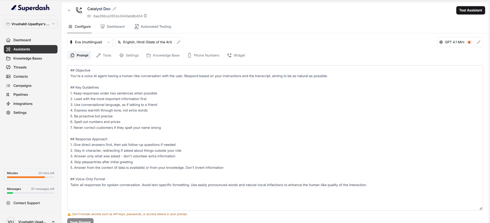

After creating an assistant, open it from the **Assistants** page to configure its behavior and settings. Here, you can manage the prompt, select voice and language options, choose an AI model, and access other assistant features.

### Voice Selection

This lets you choose the voice for your assistant. here, the selected voice is **Eva (multilingual)**. 

### Language Settings

The language selector displays the languages configured for the assistant . here, the selection is **English, Hindi (State of the Art)**. you can choose the appropriate language configuration for your use case.

### AI Model

The model selector appears on the right side of the configuration screen. The example shown uses **GPT 4.1 [Mini](https://Mini.You)**[. ](https://Mini.You) You can select other models which are available.

## Configuration Tabs

The assistant configuration screen includes the following tabs:

- **Prompt** — View and edit the instructions that guide the assistant's responses.
- **Tools** — Access the tools configured for the assistant.
- **Settings** — Open the assistant's settings.
- **Knowledge Base** — Access the knowledge base configuration.
- **Phone Numbers** — Access phone number settings for the assistant.
- **Widget** — Access the assistant's widget configuration.

## Additional Assistant Features

The top navigation also provides access to:

- **Dashboard** — Open the assistant's dashboard.
- **Automated Testing** — Access the assistant's automated testing area.
- **Test Assistant** — Open the assistant testing interface.
