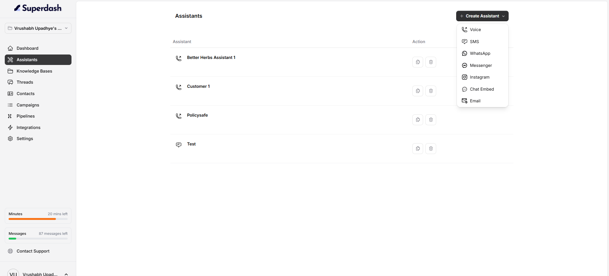
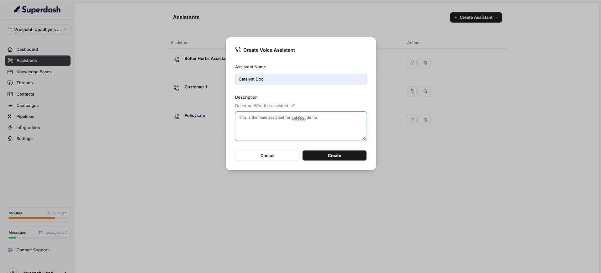

The Assistants page is where you can create and manage assistants in your workspace.

## Open Assistants

1. Log in to Catalyst.
2. Select **Assistants** from the left sidebar.
3. You will see the assistants available in your workspace.

Each row displays an assistant name and an **Action** column. The available action buttons let you copy (duplicate) in the same workspace or delete an assistant.

## Create an Assistant 

1. Click **Create Assistant** in the top-right corner.
2. Choose a communication channel from the menu.

The available options are:

- **Voice**
- **SMS**
- **WhatsApp**
- **Messenger**
- **Instagram**
- **Chat Embed**
- **Email**

## Creating a Voice Assistant

1. Click **Create Assistant**.
2. Select **Voice**.
3. Enter a name in the **Assistant Name** field.
4. Add a short description in the **Description** field (optional).
5. Click **Create**.

### Assistant Name

Choose a name that makes the assistant easy to identify. For example, `Customer Support Assistant`.
