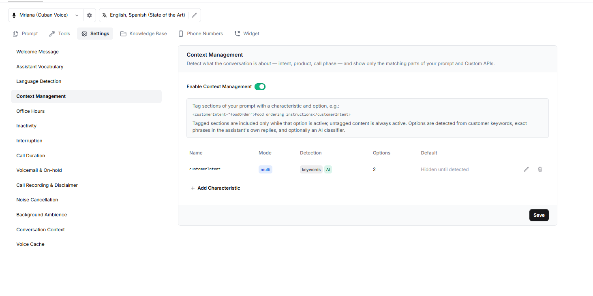
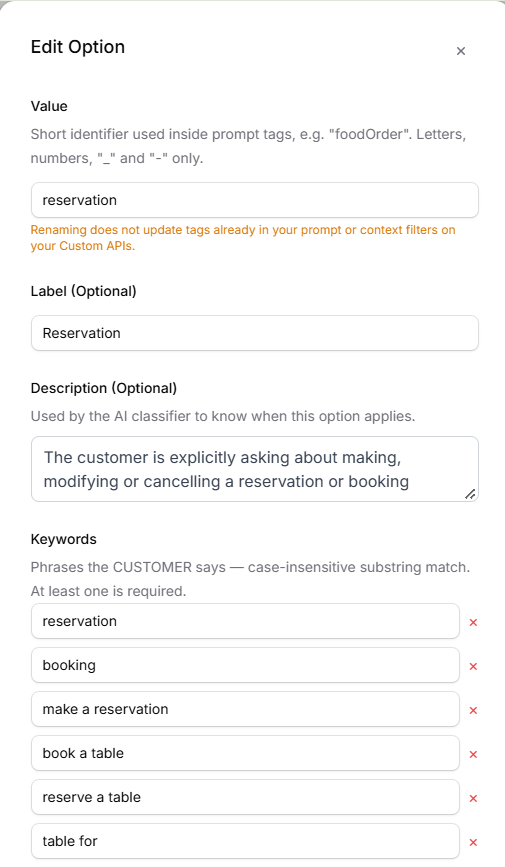

Context Management helps your assistant understand what the current conversation is about and use only the relevant parts of its prompt and Custom APIs.

For example, if a customer calls a restaurant to book a table, the assistant can use the reservation instructions instead of loading all the instructions for food orders, catering, and other enquiries.

## Overview

Context Management works using **Characteristics**. A characteristic represents something the assistant needs to identify during a conversation, such as the customer's intent, the product they are asking about.

Each characteristic can have multiple **Options** that represent its possible values.

For example, a characteristic named `customerIntent` could have these options:

- `foodOrder` – The customer wants to place a food order.
- `reservation` – The customer wants to book a table.

Once you create a characteristic and its options, you can use tags in your prompt to show which instructions should be active for each option.



## How Context Management Works

When Context Management is enabled, the assistant identifies which options are relevant to the ongoing conversation.

You can place the relevant instructions inside matching tags in your prompt.

For example:

```text
<customerIntent="foodOrder">
Take the order step by step. Confirm each item before moving on.
</customerIntent>

<customerIntent="reservation">
Collect the date, time, and party size. Help the customer with their booking.
</customerIntent>
```

When `foodOrder` is active, the food-order instructions are included. When `reservation` is active, the reservation instructions are included.

Instructions outside these tags remain active at all times. Keep general instructions, such as the greeting and the assistant's tone, outside the tags.

## How Options Are Detected



Catalyst can identify an active option in three ways:

**1. Keywords**

Keywords are words or phrases that the customer uses during the conversation.

For example, if `table for, reservation ,party of` are added as a keyword for the `reservation` option, the assistant can identify the customer's intent when they use that phrase.

Keywords are matched without considering uppercase or lowercase letters. Matching is based on complete words or phrases, not parts of other words.

**2. Assistant Phrases**

You can also add phrases that the assistant itself may say.

For example, if the assistant says, "**how many guests will be in your party**", that phrase can activate the corresponding option.

This is useful when you want a particular option to become active based on the assistant's own conversation flow.

**3. AI Detection**

You can enable AI Detection for a characteristic. The AI classifier then identifies the relevant option based on the conversation.

AI Detection is optional and can be enabled or disabled while configuring a characteristic.

## Adding a Characteristic

1. Open your assistant and go to **Settings → Context Management**.
2. Turn on **Enable Context Management**.
3. Select **Add Characteristic**.
4. Enter a name for the characteristic. Use letters, numbers, and underscores only. For example, `customerIntent`.
5. Optionally, add a description to explain what the characteristic represents.
6. Choose a **Selection Mode**:
   - **Single:** Only one option is active at a time. When a new option is detected, it replaces the previous one.
   - **Multi:** Multiple options can remain active together. Newly detected options are added without removing the existing ones.
7. Enable **AI Detection** if you want the AI classifier to identify options from the conversation.
8. Choose a **Default Option**, if required.
9. Add the options for the characteristic.
10. Select **Done**, then select **Save** on the Context Management page.

**The Default Option** determines which option is active when a conversation starts.

- **None – Hidden until detected:** No option is active initially. An option becomes active when it is detected.
- **A selected option:** That option is active from the beginning of the conversation.

## Using Context Management with Custom APIs

Context Management can also control when a Custom API is considered.

When configuring a Custom API, you can set its **Context Filter** to a characteristic and one or more of its options.

For example, an order-placement API can have a Context Filter for `customerIntent: foodOrder`. This means the API is considered only when the `foodOrder` option is active.

Custom APIs without a Context Filter are not restricted by Context Management and remain available as usual.

To configure this:

1. Go to **Tools → Custom APIs**.
2. Open the API you want to configure and Scroll down to **Advanced** and then click on **show options.**
3. Set its **Context Filter** to the required characteristic and option.
