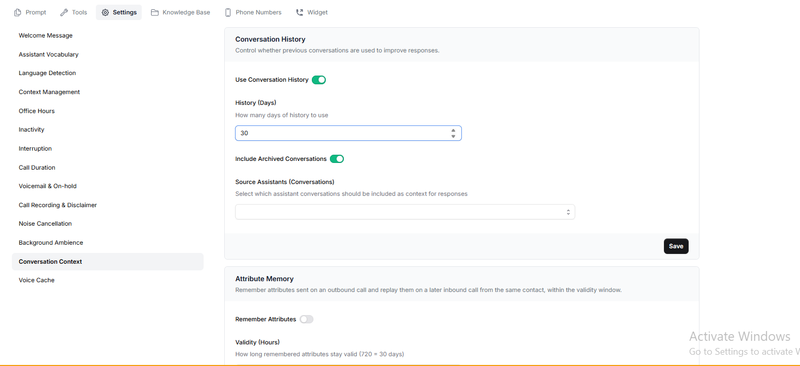

Conversation Context allows your assistant to use information from a customer's previous interactions when responding to them. This helps the assistant maintain continuity.

Conversation Context has two features: **Conversation History** and **Attribute Memory**.

## Conversation History

Conversation History allows the assistant to refer to previous conversations associated with the same contact.

### Enabling Conversation History

1. Open your assistant and go to **Settings → Conversation Context**.
2. Turn on **Use Conversation History**.
3. Under **Source Assistants**, select the assistants whose conversations you want to include.
4. Select the current assistant as well if you want it to use its own previous conversations.
5. Set **History (Days)** to choose how far back the assistant should look. For example, `30` means conversations from the last 30 days. Can be anywhere from **1 to 365 days.**
6. Turn on **Include Archived Conversations** if you want archived conversations to be included.



## Choosing How Much Conversation History the Assistant Sees

Catalyst supports two ways of providing previous conversation history to the assistant: summaries and full transcripts.

### Summaries

Summaries are the default option when Conversation History is enabled.

The assistant receives a short summary of each previous conversation instead of the complete transcript. This keeps the context concise and focused.

You do not need to add anything to your prompt to enable summaries. They are included automatically.

If you want to control where the summaries appear in your prompt, add:

`{pastContext}`

### Full Transcripts

Full transcripts provide the complete conversation, including the messages exchanged between the customer and the assistant.

This is useful when exact details from an earlier conversation matter, such as amounts, dates, or promises made to a customer.

To use full transcripts, add the following variable wherever you want the previous conversations to appear in your prompt:

`{pastConversations}`

For example:

```text
You are a loan collection agent for ABC Finance.

Here are this customer's previous conversations:

{pastConversations}

Use them to continue the conversation naturally.
```

When `{pastConversations}` is added to the prompt, full transcripts replace summaries.

## What the Assistant Receives

Each previous conversation is added as a structured entry containing its channel, date, relative time, and conversation content.

Entries are arranged from oldest to newest so the assistant can follow the order in which the interactions happened.

Dates appear in `YYYY-MMM-DD` format, along with a relative time such as `2 days ago` or `3 hours ago`.

### Example: Conversation Summary

A summary entry may look like this:

```text
CHANNEL: VOICE CALL
DATE: 2026-Oct-20
RELATIVETIME: 10 days ago
SUMMARY: The customer called to enquire about upgrading their existing internet plan. They wanted a faster connection for working from home. The assistant explained the available plans and recommended the 500 Mbps plan. The customer said they would discuss it with their family before making a decision.
```

### Example: Full Transcript

With full transcripts enabled, the conversation is included word-for-word:

```text
CHANNEL: WHATSAPP
DATE: 2026-Oct-25
RELATIVETIME: 5 days ago
CONVERSATION:
Customer: Hi, I called a few days ago about upgrading my internet plan. Can you share the details of the 500 Mbps plan?
Assistant: Of course! The 500 Mbps plan offers faster speeds, making it suitable for working from home and streaming.
Customer: What would be the monthly price?
Assistant: The monthly price is ₹999.
Customer: Okay, that sounds good. I would like to go ahead with this plan.
Assistant: Certainly! I'll help you with the upgrade process.
```

## Attribute Memory

Attribute Memory allows the assistant to remember attributes sent during an outbound call and reuse them during a later inbound call from the same contact.

This is useful when you want the assistant to retain information from an earlier outbound interaction.<br /><br />Ex: \{

  "customerName": "Rahul",

  "loanType": "Home Loan",

  "loanAmount": "250000",

 "applicationStatus": "Documents Pending"

\}

The validity period is measured in hours. For example, `720` means the attributes remain valid for 30 days.

Once the configured validity period expires, those remembered attributes are no longer available through this feature.
