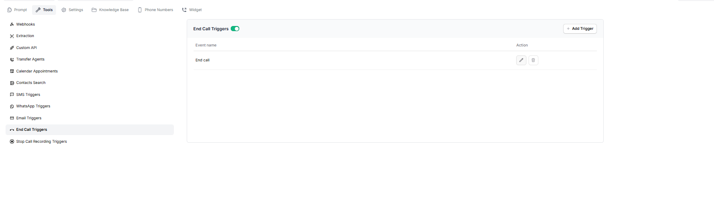
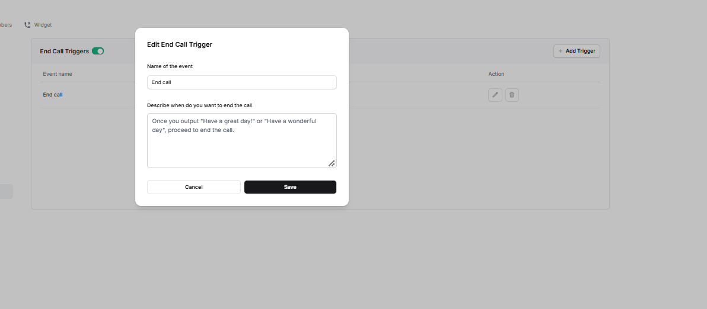

End Call Triggers allow you to define when the assistant should end a call. You can create a trigger by giving it a name and describing the condition or response after which the call should end.

For example, you can instruct the assistant to end the call after saying its final goodbye to the customer.

**Use the toggle beside End Call Triggers to enable or disable the feature**

## Add an End Call Trigger

1. Click **Add Trigger**.
2. Enter the **Name of the event**.  Example: `End call Trigger`
3. In **Describe when do you want to end the call**, explain the condition that should cause the assistant to end the call. 

   **Example:**

   "Once you output 'Have a great day!' or 'Have a wonderful day', proceed to end the call."
4. Click **Save**.

**On the End Call Triggers page, You can edit an existing trigger or delete the one you no longer need.**
