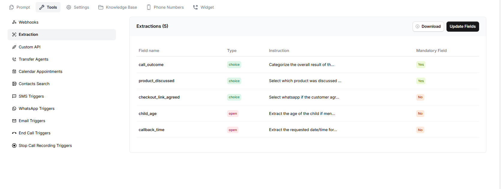
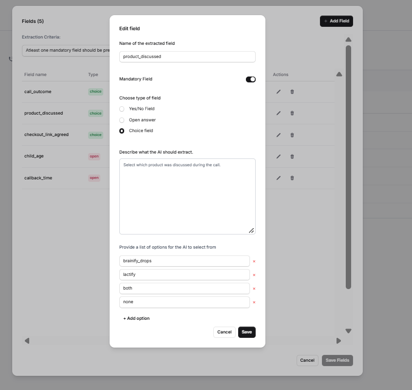

Extraction allows you to collect specific information from a conversation and save it in structured fields. You can define what the assistant should extract, choose the field type, and decide whether a field is mandatory.

For example, you can extract which product was discussed during a call, whether a customer agreed to receive a link, or when they requested a callback.  The Extraction page displays the fields configured for the selected assistant, including their names, types, instructions, and mandatory status.

## Add or Update Extraction Fields

Click **Update Fields** to open the extraction field configuration.

### Add a Field

1. Click **Add Field**.
2. Enter the **Name of the extracted field**. Choose a clear name that describes the information you want to collect.
3. Enable or disable **Mandatory Field**, depending on whether the field is required.
4. Select the field type.
5. Enter instructions explaining what the AI should extract.
6. If you select **Choice field**, add the available options.
7. Click **Save** to save the field.
8. After making your changes, click **Save Fields** to save the overall configuration.

To edit an existing field, click the edit icon beside it. To remove a field, click the delete icon.  Field Types

Catalyst provides three field types in the Extraction configuration.

### 1. Yes/No Field

Use this type when the answer should be either Yes or No.

**Example:** `checkout_link_agreed`

**Instruction:** Identify whether the customer agreed to receive the checkout link.

### 2. Open Answer

Use this type when the answer can vary and needs to be captured as text.

**Example:** `callback_time`

**Instruction:** Extract the date and time requested by the customer for a callback.

### 3. Choice Field

Use this type when the answer must be selected from a predefined list of options. You can add the available options while configuring the field.

**Example:** `product_discussed`

Suppose your assistant discusses Brainify Drops and Lactify with customers. You can configure this field as follows:

- **Field name:** `product_discussed`
- **Mandatory Field:** Enabled
- **Type:** Choice field
- **Instruction:** Select which product was discussed during the call.

**Options:**

- `brainify_drops`
- `lactify`
- `both`
- `none`

The assistant uses the conversation and the instructions provided to select the option that best matches the discussion. For example, if both products were discussed, it can select `both`.

## Mandatory Fields

Enable **Mandatory Field** when a field is required in your extraction configuration. Leave it disabled when the field is optional.

For example, you might make `product_discussed` mandatory if every call must have a product category recorded. A field such as `callback_time` could remain optional because not every customer will request a callback.

## Write Clear Extraction Instructions

Each field includes an instruction box labelled **Describe what the AI should extract**. Use it to explain exactly what information the assistant should identify and how it should choose the answer.

For example, for the `product_discussed` field, you could write:

"Select which product was discussed during the call."

## Download Extraction Fields

Click **Download** on the Extraction page to download the configured fields. This can help you review the field configuration outside Catalyst.
