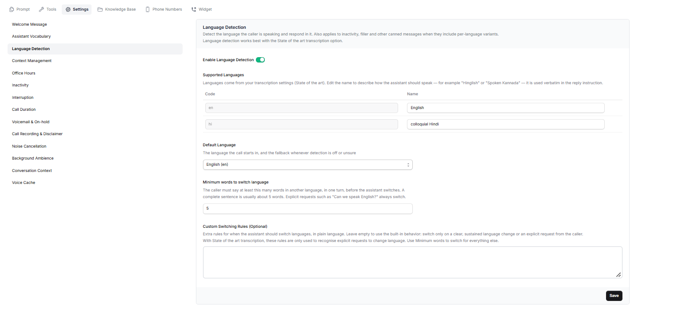

Language Detection allows the assistant to identify the language the caller is speaking and respond in that language. It also applies to inactivity, filler, and other pre-written messages when language-specific versions are available.

## Enable Language Detection

You can toggle **Enable Language Detection** on or off depending on whether you want the assistant to automatically detect the caller's language and respond accordingly.

## Supported Languages

The supported languages come from the assistant's transcription settings, specifically the **State of the art** transcription option.

Each language has a code and a name. You can edit the name to describe how the assistant should speak that language.

For example:

- `en` — English
- `hi` — colloquial Hindi

You can use names such as _Hinglish_ or _Spoken Kannada_ to guide the assistant's response style.

## Default Language

Choose the default language from the dropdown.

This is the language used when the call starts and the fallback language when detection is turned off or the detected language is uncertain.

## Minimum Words to Switch Language

Set the minimum number of words the caller must say in another language during one turn before the assistant switches languages.

The default value shown is **5 words**. A complete sentence is usually around five words.

Explicit requests such as “Can you please speak English?” always trigger a language switch.

## Custom Switching Rules (Optional)

Use this field to add extra instructions describing when the assistant should switch languages.

Leave it empty to use the built-in behaviour, which switches languages when there is a clear, sustained language change or when the caller explicitly asks to switch.

With **State of the art** transcription, these rules are used only to recognise explicit requests to change language. The minimum-word setting is used for other language switches.

**Example** : Do not switch languages unless the caller explicitly asks you to or speaks more than 5 words in another language.
