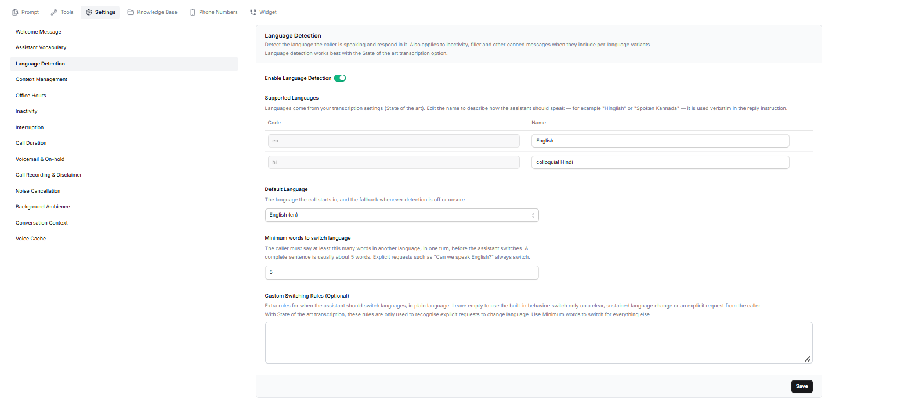

Language Detection lets your Assistant notice which language the caller is speaking and reply in that language. It also applies to inactivity, filler and other pre-written messages, as long as you have written a version for each language.

<Info>
  Language Detection works best with the **State of the art** transcription option. The languages you can choose come from that setting.
</Info>

### Enable Language Detection

Turn this on to let the Assistant detect and switch languages. When it is off, the Assistant stays in the default language for the whole call.

### Supported Languages

Each language has a **code** and a **name**. The code is fixed. You can edit the name, and the Assistant uses it word for word as its instruction for how to speak that language.

This means the name controls the **style** of speech, not just the language. Choose a name that describes how your callers actually talk:

| Code | Name you could use | What the Assistant does |
| :-- | :-- | :-- |
| `hi` | Colloquial Hindi | Speaks everyday Hindi, not formal or textbook Hindi |
| `hi` | Hinglish (Hindi words in Devanagari, English words in English letters) | Mixes Hindi and English the way people do in conversation |
| `kn` | Spoken Kannada | Speaks everyday Kannada, as people talk on the phone, not textbook Kannada |
| `ta` | Everyday spoken Tamil | Speaks informal, everyday Tamil |

<Tip>
  Be specific. "Hindi" may come out formal. "Colloquial Hindi" or "Hinglish" tells the Assistant to sound like a real person on a call. You can also say which script to use, such as "Hindi words in Devanagari, English words in English letters".
</Tip>

### Default Language

The language the call starts in. It is also the fallback whenever detection is off or the Assistant is unsure which language the caller is speaking.

<Note>
  Pick the language most of your callers speak. Your welcome message should be in this language too.
</Note>

### Minimum words to switch language

How many words the caller must say in another language, in one turn, before the Assistant switches. The default is **5**, which is about one full sentence. This stops the Assistant from switching on a single word. For example, a Hindi speaker who says "OK" or "yes" stays in Hindi.

<Info>
  A direct request, such as "Can you speak in English?", always switches the language, whatever this number is.
</Info>

### Custom Switching Rules (optional)

Extra instructions, in plain language, for when to switch. Leave it empty to use the built-in behaviour: switch only on a clear change of language, or when the caller asks.

<Warning>
  With State of the art transcription, these rules are only used to recognise **direct requests** to change language. All other switching follows **Minimum words to switch language**.
</Warning>

**Example**

```text
- Switch to English only when the user asks for English; English words mixed
  into Hindi sentences are normal Hinglish, so stay in Hinglish.
- If the user asks for a language that is not supported, stay in Hindi.
```
