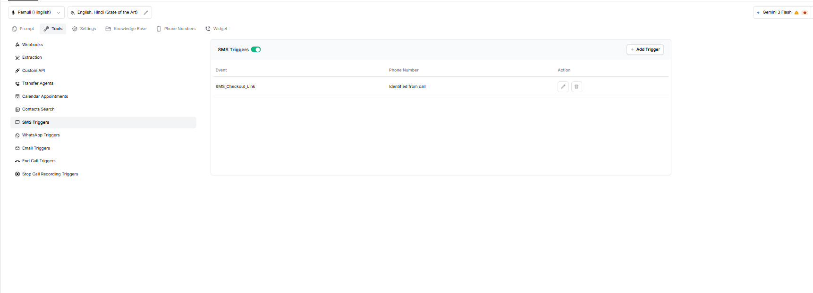
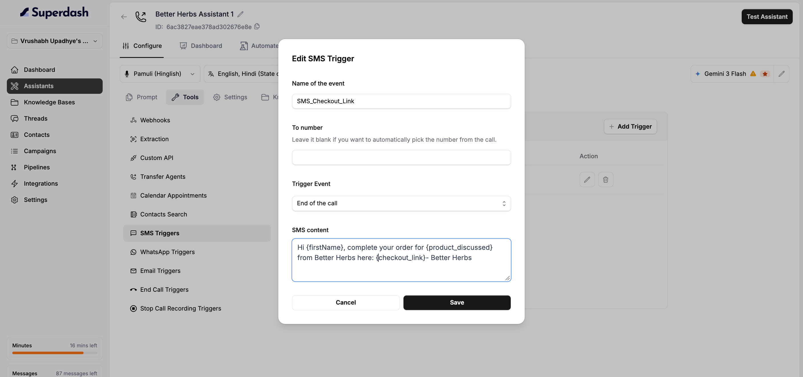

SMS Triggers allow your assistant to send an SMS message when a specific event occurs during a call. You can configure the event, choose when the message should be sent, and write the SMS content.

For example, an assistant can send a customer a checkout link at the end of a call.

The SMS Triggers page displays the configured triggers, their event names, phone number settings, and available actions.

## Enable or Disable SMS Triggers

Use the toggle beside **SMS Triggers** to enable or disable the feature.

Keep it enabled when you want the assistant to use the configured SMS triggers.

## Add an SMS Trigger

1. Click **Add Trigger**.
2. Enter the **Name of the event**. Use a clear name to identify the trigger.
3. Enter a phone number in **To number**, if you want to specify a particular number or leave it empty if you want the system to automatically pick the phone number from the call.
4. Choose the **Trigger Event** that determines when the SMS should be sent. here you can select "During the call" , "Start of the call", and "End of Call"
5. Enter the message in **SMS content**.

### SMS Content

Enter the message you want to send to the customer. You can use supported variables to personalize the message with information from the conversation.

**Example:**

Hi `{firstName}`, complete your order for `{product_discussed}` from XYZ company here: `{checkout_link}` - XYZ company

In this example:

- `{firstName}` represents the customer's first name.
- `{product_discussed}` represents the product discussed.
- `{checkout_link}` represents the checkout link.

Make sure the variables you use are supported and available in your assistant's configuration.

## Edit or Delete an SMS Trigger

On the SMS Triggers page, use the action icons beside a configured trigger to edit or delete it.
