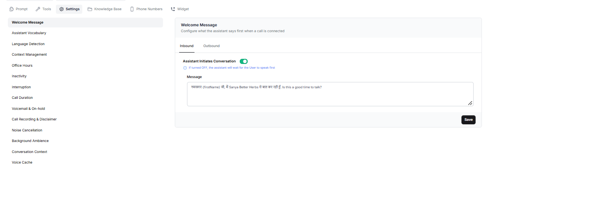

The Welcome Message setting lets you configure what the assistant says when a call connects. You can set different welcome messages for inbound and outbound calls.

## Configure the Welcome Message

### Inbound and Outbound Calls

The Welcome Message section has two tabs:

- **Inbound:** Configure the welcome message for incoming calls.
- **Outbound:** Configure the welcome message for outgoing calls.

Select the tab you want to configure and enter the message in the **Message** field.

### Assistant Initiates Conversation

Use the **Assistant Initiates Conversation** toggle to control whether the assistant starts speaking when the call connects.

When this option is turned off, the assistant waits for the user to speak first.

### Message

Enter the greeting you want the assistant to say when the call connects. Keep it clear, natural, and appropriate for the type of call.

**Example:**

“Hello \{firstName\}, this is Sanya calling from XYZ company . Is this a good time to talk?”

You can use supported variables, such as `{firstName}`, to personalize the greeting. Make sure any variables you use are available and correctly configured for your assistant.
