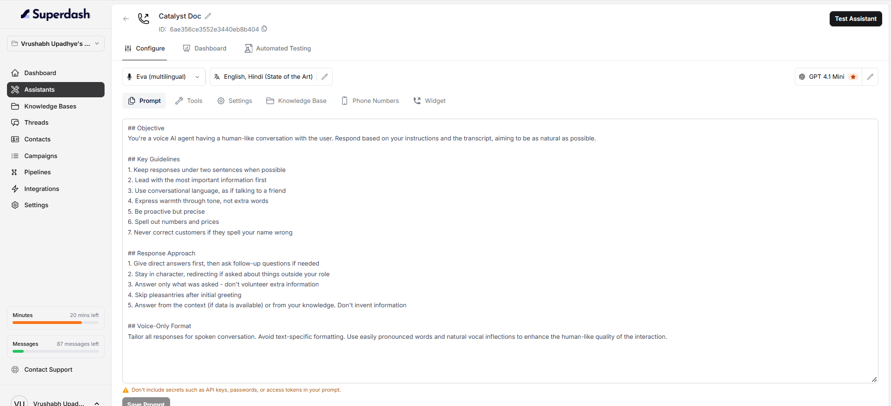
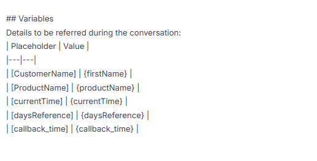

The prompt defines how your assistant should behave and respond during conversations. You can edit the prompt to set instructions for the assistant and update its behaviour based on your requirements. 

## Write a Clear Prompt

A well-structured prompt helps the assistant understand its role, follow the right conversation flow, and respond appropriately to different situations. You can organize your prompt using the following sections.

### 1. Objective

Explain who the assistant is, which company it represents, and what it needs to accomplish.

**Example:** You are a customer support assistant at ABC Company. Your goal is to help customers with their queries.

### 2. Key Guidelines

Add general instructions that the assistant should follow throughout the conversation, such as response length, language, tone, and how to handle information.

**Example:** Keep responses short, use natural conversational language, and never invent information.

### 3. Conversation Flow

Divide the conversation into phases and steps so the assistant knows what to do from the beginning to the end.

**Example:** Introduce yourself, explain the reason for the call, understand the customer's needs, and close the conversation politely.

### 4. Special Scenarios and Objection Handling

Explain how the assistant should respond to situations such as a customer refusing, asking for a callback, giving an unclear answer, or contacting the wrong person.

**Example:** If the customer is not interested, acknowledge their response politely and follow the defined closing flow.

### 5. Customer Questions and Answers

Describe how the assistant should answer common questions and what it should do when the required information is unavailable.

**Example:** Answer using the available approved information. If the answer is unavailable, follow the defined fallback instructions instead of guessing.

### 6. Response Approach

Define how the assistant should respond during the conversation, including whether to answer directly, ask follow-up questions, or stay within a specific role.

**Example:** Answer the customer's question directly and ask a follow-up question only when needed.

### 7. Variables

These variables include the dynamic values needed during the conversation, using the variable names supported by your configuration.  You can also include a **Variables** section at the end of your prompt to list the variables used and explain what each one represents, as shown.

- Use **Test Assistant** to test how the assistant responds. You can test using a **phone call, web call, or text.**
- If the assistant does not behave as expected, update the relevant instructions, save the prompt again, and retest.
